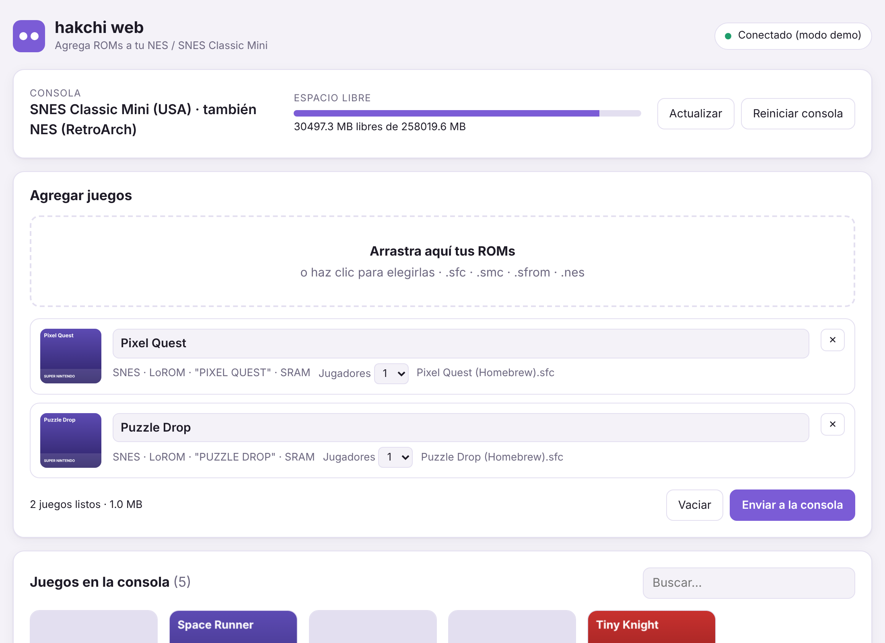
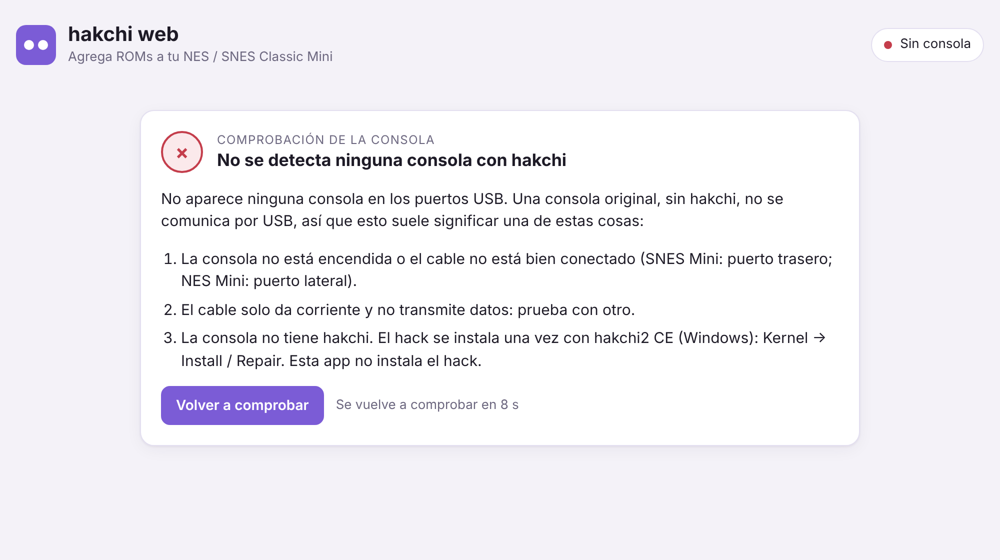
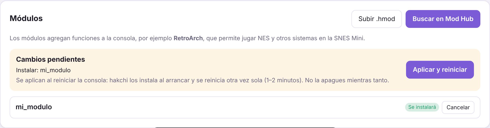
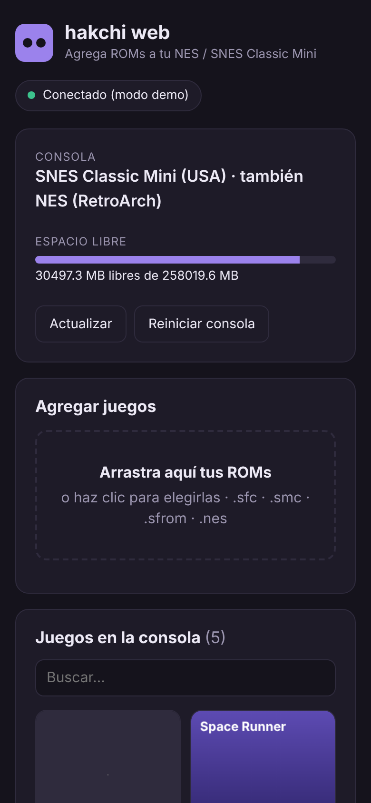

# hakchi web

**Agrega juegos y módulos a tu SNES Classic Mini o NES Classic Mini desde el navegador.**
Funciona en Linux, Windows y macOS, sin instalar hakchi2 CE en el día a día.

[](https://github.com/kevinvarela/hakchi-web/actions/workflows/test.yml)
[](LICENSE)




> **English summary** — *hakchi web* is a browser-based manager for NES / SNES Classic Mini consoles that
> already have [hakchi CE](https://github.com/TeamShinkansen/Hakchi2-CE) installed. It runs locally on your
> computer, connects to the console over its USB network, and lets you add, rename and remove games
> (with automatic `.sfrom` conversion for SNES ROMs, cover art and RetroArch support), and install or remove
> hakchi modules (`.hmod`), including from the Mod Hub. It does **not** install the hakchi hack itself.
> Linux, Windows and macOS. GPL-3.0-or-later. The UI is in Spanish; contributions are welcome.

---

## Índice

- [Qué es](#qué-es)
- [Funciones](#funciones)
- [Estado del proyecto](#estado-del-proyecto)
- [Requisitos](#requisitos)
- [Instalación](#instalación)
- [Uso](#uso)
- [Juegos](#juegos)
- [Módulos (hmods)](#módulos-hmods)
- [Comprobación de la consola](#comprobación-de-la-consola)
- [Linux: red USB](#linux-red-usb)
- [Modo demo](#modo-demo)
- [Opciones](#opciones)
- [Problemas comunes](#problemas-comunes)
- [Cómo funciona](#cómo-funciona)
- [Seguridad](#seguridad)
- [Desarrollo](#desarrollo)
- [Aviso legal](#aviso-legal)
- [Licencia y créditos](#licencia-y-créditos)

---

## Qué es

**hakchi web** es una aplicación que se ejecuta en tu ordenador y se usa desde el navegador
(`http://localhost:8080`). Se conecta por el cable USB con tu consola **ya hackeada con hakchi CE** y te
permite gestionar sus juegos y módulos de forma sencilla.

Usa el mismo formato que [hakchi2 CE](https://github.com/TeamShinkansen/Hakchi2-CE), así que los juegos que
agregues con una herramienta se ven en la otra.

> ⚠️ **hakchi web no instala el hack.** La primera vez hay que instalar hakchi CE en la consola con
> hakchi2 CE (Windows): *Kernel → Install / Repair*. Después ya puedes usar solo esta app.

## Funciones

**Juegos**
- Arrastrar y soltar ROMs de **SNES** (`.sfc`, `.smc`, `.sfrom`) y **NES** (`.nes`).
- Conversión automática de ROMs de SNES a **`.sfrom`** para el emulador original de la consola
  (detección LoROM/HiROM, Super FX, DSP-1, SA-1, presets de juegos conocidos, eliminación de cabecera de copiador).
- Detección de ROMs de NES: mapper, batería (partidas guardadas), *four screen* y *trainer*.
- **Avisos antes de enviar**: juegos que dan problemas con el emulador original, mappers no soportados,
  juegos repetidos o falta de espacio.
- **Juegos de otro sistema con RetroArch**: NES en la SNES Mini (y SNES en la NES Mini). La app detecta qué
  emuladores tiene la consola o copia la configuración de juegos que ya funcionan.
- **Carátulas**: elige una imagen o se genera una automáticamente con el nombre del juego.
  Se redimensionan al tamaño que usa la consola.
- Editar nombre y número de jugadores antes de enviar.
- Lista de juegos de la consola con carátulas, búsqueda, **renombrar** y **quitar**.
- Mantiene los **juegos de fábrica** al crear el menú personalizado (sin duplicarlos ni tocar sus partidas).
- Espacio libre de la consola.

**Módulos**
- Ver los módulos instalados y desinstalarlos.
- **Mod Hub**: buscar e instalar módulos del mismo repositorio que usa hakchi2 CE (por ejemplo **RetroArch**),
  con verificación MD5/SHA1 de la descarga.
- Subir tus propios `.hmod` (o un `.zip` con la carpeta del módulo).
- Cambios pendientes que se aplican al reiniciar, **sin modo FEL**.

**Y además**
- **Pantalla de comprobación** al abrir: detecta si la consola tiene hakchi, si está en modo FEL o si falta
  configurar la red USB, y explica qué hacer.
- **Configuración automática de la red USB en Linux** desde el lanzador.
- **Modo demo** con una consola simulada para probar sin hardware.
- Interfaz en español, modo claro y oscuro, y adaptada a móvil.
- Solo accesible desde tu propio ordenador, con protección CSRF y *DNS rebinding*.

| Comprobación de la consola | Módulos | Móvil (modo oscuro) |
|---|---|---|
|  |  |  |

## Estado del proyecto

Versión **1.0**. Lo que se ha probado hasta ahora:

| Función | Estado |
|---|---|
| Conexión y agregar juegos en SNES Mini con Linux | ✅ Probado con consola real |
| Conversión `.sfrom`, juegos NES con RetroArch, módulos, Mod Hub, pantalla de comprobación | 🧪 Probado con la consola simulada y pruebas automáticas; falta probarlo con más consolas reales |
| Windows y macOS | 🧪 Sin probar todavía con consola real |

Si lo pruebas en otra consola o sistema, [cuéntalo en un issue](https://github.com/kevinvarela/hakchi-web/issues):
ayuda mucho.

## Requisitos

- Una **SNES Classic Mini** (USA/EUR/JPN, Super Famicom Mini) o **NES Classic Mini** (o Famicom Mini)
  con **hakchi CE** instalado.
- Un **cable micro-USB de datos** (los cables que solo cargan no sirven).
  - SNES Mini: puerto **trasero**. NES Mini: puerto **lateral**.
- [**Node.js 18 o superior**](https://nodejs.org).
- **Windows**: el driver USB de la consola que instala hakchi2 CE (si hackeaste la consola en ese PC, ya lo tienes).
- **Linux / macOS**: no hace falta driver.
- Internet solo para el Mod Hub.

## Instalación

**Opción 1 — Descargar**: en GitHub pulsa **Code → Download ZIP** y descomprímelo.

**Opción 2 — Git**:

```bash
git clone https://github.com/kevinvarela/hakchi-web.git
cd hakchi-web
```

Las dependencias se instalan solas la primera vez que abres la app con el lanzador. También puedes hacerlo a mano:

```bash
npm install
```

## Uso

1. Conecta la consola al ordenador por USB y enciéndela. Espera a que la tele muestre el menú.
2. Abre la app:
   - **Windows**: doble clic en `iniciar-windows.bat`
   - **Linux / macOS**:
     ```bash
     ./iniciar-mac-linux.sh
     ```
   - O con Node directamente: `npm start`
3. Se abre `http://localhost:8080` en el navegador.
4. Arrastra tus ROMs, revisa nombre, carátula y jugadores, y pulsa **Enviar a la consola**.
   La tele se queda en negro unos segundos y vuelve con los juegos nuevos.

Para cerrar la app, pulsa `Ctrl + C` en la terminal.

## Juegos

| Formato | Consola SNES Mini | Consola NES Mini |
|---|---|---|
| `.sfc`, `.smc` | Emulador original (se convierte a `.sfrom`) | RetroArch (`snes9x`), si está instalado |
| `.sfrom` | Emulador original, sin conversión | No compatible |
| `.nes` | RetroArch (`fceumm` u otro), si está instalado | Emulador original |

- **Juegos problemáticos**: algunos juegos de SNES (chips especiales, ciertos hacks) no funcionan bien con el
  emulador original. La app avisa de los que se conocen; para ellos es mejor RetroArch.
- **Mappers de NES**: el emulador original de la NES Mini solo soporta los mappers
  0, 1, 2, 3, 4, 5, 7, 9, 10, 86, 87 y 184.
- **Juegos de fábrica**: la primera vez que agregas un juego, la app crea accesos a los juegos de fábrica para
  que no desaparezcan del menú. "Quitar" un juego de fábrica solo lo oculta; no se borra de la consola.
- Si una ROM está comprimida (`.zip`), descomprímela antes.

## Módulos (hmods)

Los módulos agregan funciones a la consola. El más habitual es **RetroArch**, que permite jugar NES, Game Boy,
Mega Drive y otros sistemas en la SNES Mini.

1. En la sección **Módulos**, pulsa **Buscar en Mod Hub** y busca el módulo (por ejemplo "RetroArch"),
   o pulsa **Subir .hmod** si ya lo tienes descargado.
2. Pulsa **Instalar**. El módulo queda como **cambio pendiente**.
3. Pulsa **Aplicar y reiniciar**. La consola se reinicia, hakchi instala o desinstala los módulos al arrancar
   y se reinicia otra vez sola. Tarda 1–2 minutos: **no la apagues mientras tanto**.

Para desinstalar, pulsa **Desinstalar** en el módulo y después **Aplicar y reiniciar**.

> Los módulos se ejecutan con permisos de administrador en la consola. Instala solo módulos de fuentes de confianza.

Si un módulo del Mod Hub viene en un formato que la app no sabe abrir (por ejemplo `.7z`), la app te da el
enlace para descargarlo; conviértelo a `.zip` o `.hmod` y súbelo.

## Comprobación de la consola

Al abrir la app, una pantalla previa comprueba la consola y vuelve a comprobar sola cada pocos segundos:

| Situación | Qué muestra |
|---|---|
| Consola con hakchi, conectada | Entra directamente a la app |
| Con hakchi, pero Linux no configuró la red USB | El comando exacto para configurarla, con botón **Copiar** |
| Con hakchi, todavía arrancando | Espera unos segundos |
| Modo FEL (se encendió con RESET pulsado) | Cómo salir de ese modo |
| No aparece ninguna consola | Las causas posibles: apagada, cable solo de carga o **consola sin hakchi** (una consola original no se comunica por USB) |

La detección del USB funciona en Linux. En Windows y macOS se muestra una guía general.

## Linux: red USB

Con hakchi, la consola aparece como una tarjeta de red USB (`04e8:6863`) en la dirección `169.254.13.37`.
En Linux esa tarjeta cambia de nombre en cada conexión (`enx…`) y no recibe dirección, por eso el ordenador
no ve la consola.

- **El lanzador `iniciar-mac-linux.sh` lo configura solo** al abrir la app (puede pedirte la contraseña de `sudo`).
- La pantalla de comprobación muestra el comando exacto si hace falta.
- Después de reiniciar la consola (por ejemplo al instalar módulos), vuelve a abrir el lanzador.

Para dejarlo configurado de forma permanente:

```bash
echo 'SUBSYSTEM=="net", ACTION=="add", ATTRS{idVendor}=="04e8", ATTRS{idProduct}=="6863", NAME="hakchi0"' | sudo tee /etc/udev/rules.d/70-hakchi.rules && sudo udevadm control --reload
```

```bash
nmcli con add type ethernet ifname hakchi0 con-name hakchi ipv4.method manual ipv4.addresses 169.254.1.2/16 ipv6.method ignore
```

Desconecta y vuelve a conectar la consola. (La regla también renombraría un móvil Samsung conectado en modo
módem USB; para quitarla: `sudo rm /etc/udev/rules.d/70-hakchi.rules`.)

## Modo demo

Para probar la app sin consola:

```bash
npm run demo
```

o `./iniciar-mac-linux.sh --demo`. Simula una SNES Mini (USA) con tres juegos de fábrica y RetroArch "instalado".
Puedes probar todo: agregar, renombrar y quitar juegos, y subir o desinstalar módulos. El reinicio es simulado.

```bash
node server.js --demo --system nes          # simular una NES Mini
DEMO_NO_RETROARCH=1 node server.js --demo   # simular una consola sin RetroArch
```

La consola simulada se guarda en la carpeta temporal del sistema (`hakchi-web-demo-snes` / `-nes`).
Bórrala para empezar de cero. Los juegos no se pueden jugar en la demo.

## Opciones

| Opción | Por defecto | Descripción |
|---|---|---|
| `--port <n>` / `PORT` | `8080` | Puerto de la web |
| `--console <ip>` / `CONSOLE_HOST` | `169.254.13.37` | Dirección de la consola |
| `--demo` | — | Consola simulada |
| `--system nes\|snes` | `snes` | Consola de la demo |
| `HAKCHI_MODHUB_URL` | Mod Hub de KMFDManic | Repositorio de módulos |

```bash
node server.js --port 9000 --console 169.254.13.37
```

## Problemas comunes

**"No se detecta ninguna consola"**
Comprueba que la consola está encendida y mostrando el menú, que el cable es de datos y que está en el puerto
correcto. Si nunca le instalaste hakchi, hazlo primero con hakchi2 CE.

**"Consola con hakchi detectada, falta configurar la red USB"** (Linux)
Copia el comando que muestra la app o abre la app con `./iniciar-mac-linux.sh`. Ver [Linux: red USB](#linux-red-usb).

**La consola responde al `ping` pero la app no conecta**
Una VPN (por ejemplo Cloudflare WARP) puede estar desviando las direcciones `169.254.x.x`. Desconéctala y vuelve a probar.

**Un juego de NES da error C7 en la SNES Mini**
La consola no tiene un emulador de NES. Instala **RetroArch** desde **Módulos → Buscar en Mod Hub**, quita el
juego y vuelve a agregarlo.

**Un juego de SNES aparece pero no arranca**
Puede ser un juego incompatible con el emulador original. Instala RetroArch y usa la ROM con él.

**Windows no detecta la consola**
Instala el driver USB que viene con hakchi2 CE.

Si el problema sigue, abre un [issue](https://github.com/kevinvarela/hakchi-web/issues) con tu consola,
sistema operativo y lo que muestra la terminal (la línea que empieza con `Consola:`).

## Cómo funciona

```
Navegador ──HTTP──▶ servidor local (Node.js, 127.0.0.1:8080) ──SSH por USB──▶ consola (hakchi CE, 169.254.13.37)
```

- **Conexión**: SSH a la consola (`root`, sin contraseña, como en hakchi CE) por la red USB.
- **Detección**: comandos de hakchi (`hakchi eval`, `findGameSyncStorage`, `get squashfs/gamepath`) para saber el
  tipo de consola, la carpeta de juegos y el espacio libre.
- **Juegos**: cada juego es una carpeta `CLV-X-XXXXX` con la ROM, el archivo `.desktop` y las carátulas, en
  `/var/lib/hakchi/games/<consola>/000/`. Se envían en un único `.tar` y se extraen en la consola.
  La interfaz de la consola se detiene durante la copia y se vuelve a montar al terminar (`uistop`,
  `hakchi overmount_games`, `uistart`).
- **Módulos**: los `.hmod` se dejan en la carpeta `transfer` de hakchi y los que hay que quitar se anotan en
  `transfer/uninstall`. hakchi los procesa al arrancar. No se usa el modo FEL.
- **Carátulas**: se redimensionan en el navegador (228×204 y 40×40).

Estructura del código:

```
server.js            Servidor web y API
lib/hakchi.js        Operaciones con la consola (detectar, listar, enviar, quitar, renombrar)
lib/roms.js          Procesamiento de ROMs (.sfrom, NES, .desktop, emuladores)
lib/mods.js          Módulos y Mod Hub
lib/detect.js        Comprobación previa (USB y conexión)
lib/archive.js       Lectura de .tar, .tar.gz y .zip
lib/tar.js           Creación de .tar
lib/shell.js         Conexión SSH y shell local (demo)
lib/demo.js          Consola simulada
public/              Interfaz web
test/run.js          Pruebas
```

## Seguridad

- El servidor **solo escucha en `127.0.0.1`**: no es accesible desde otros equipos.
- La API comprueba que las peticiones vayan dirigidas a `localhost` (*DNS rebinding*) y exige una cabecera
  propia en las que cambian algo (*CSRF*), para que ninguna web que visites pueda controlar tu consola.
- El modo demo nunca reinicia ni modifica tu ordenador fuera de su carpeta temporal.

Para reportar una vulnerabilidad, consulta [SECURITY.md](SECURITY.md).

## Desarrollo

```bash
npm install
npm run demo   # app con consola simulada en http://localhost:8080
npm test       # pruebas: ROMs, módulos, detección y flujo completo en modo demo
```

Las pruebas generan ROMs sintéticas; el repositorio no contiene ROMs. Las contribuciones son bienvenidas:
consulta [CONTRIBUTING.md](CONTRIBUTING.md).

## Aviso legal

- Este proyecto **no incluye ROMs, BIOS ni juegos** y no enlaza a ellos. Usa solo copias de seguridad de juegos
  que poseas legalmente o juegos homebrew.
- Modificar la consola puede anular su garantía. Úsalo bajo tu responsabilidad: el software se proporciona
  **sin garantía de ningún tipo** (ver [LICENSE](LICENSE)).
- Nintendo, NES, Super Nintendo, SNES, Famicom y Super Famicom son marcas registradas de Nintendo.
  Este proyecto no está afiliado, patrocinado ni aprobado por Nintendo.

## Licencia y créditos

**hakchi web** — Copyright (C) 2026 [Kevin Varela](https://github.com/kevinvarela).

Publicado bajo la **[GNU General Public License v3.0 o posterior](LICENSE)** (GPL-3.0-or-later).
Puedes usarlo, estudiarlo, modificarlo y compartirlo libremente. Si distribuyes una versión modificada, debe
publicarse también bajo GPL-3.0 con su código fuente: el proyecto seguirá siendo siempre abierto.

Partes de este proyecto se basan en el trabajo de
[hakchi2 CE](https://github.com/TeamShinkansen/Hakchi2-CE) (Team Shinkansen) y
[hakchi](https://github.com/ClusterM/hakchi) (Alexey "Cluster" Avdyukhin, madmonkey y colaboradores),
ambos GPL-3.0. Detalles en [NOTICE.md](NOTICE.md). ¡Gracias a toda la comunidad de hakchi!
